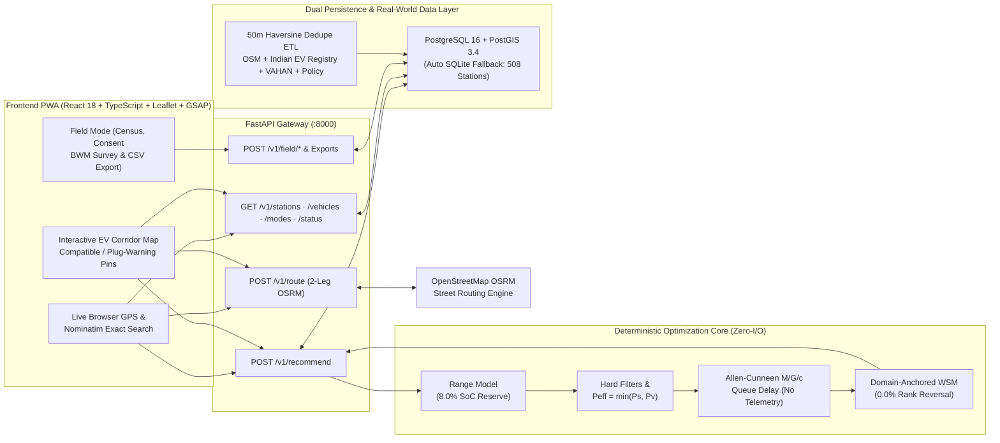

# CERCOS — Cognitive EV Route and Charging Optimization System

> **VIT Bhopal University · EPICS Team `EPICS24-220`**  
> **Domain:** EV Route Optimization · **Phase-I Status:** Completed (`40%` Committed Scope — Stages `P0` to `P4`)  
> **Study Region:** Bhopal – Sehore – Kothri Kalan – Ashta – Dewas – Indore Corridor, Madhya Pradesh, India  

[](https://github.com/anshere0/CERCOS/actions/workflows/ci.yml)

---

## Overview & Problem Statement

Consumer navigation maps treat EV charger selection as a single-criterion proximity search, routing every driver to the geometrically closest charger pin. Across Madhya Pradesh—where **97.18%** of CY 2024 new EV registrations (`MoRTH VAHAN 4.0`) are light **two-wheelers (`49.61%`)** and **three-wheelers (`47.57%`)** rather than four-wheel cars (`2.37%`)—nearest-pin routing creates four structural failures:

1. **Onboard BMS Charge Acceptance Bottleneck ($P_{\text{eff}}$ Tariff Trap):** Sending a `1.5–3.3 kW` E2W/E3W to a `60 kW` commercial DC fast charger yields zero charging acceleration ($P_{\text{eff}} = \min(P_{\text{station}}, P_{\text{vehicle}})$) while charging premium DC tariffs (`INR 19–22/kWh` vs `INR 12–13.5/kWh` AC).
2. **Physical Connector Mismatches:** Light EVs (`LECCS`, `15A_Socket`, `Bharat_DC001`) are routed to incompatible `CCS2`-only highway plazas.
3. **Unmeasured Queue Congestion:** Without open CPO telemetry feeds, nearest urban hubs experience peak delays (`>30 min`) while nearby chargers sit idle.
4. **Algorithmic Rank Reversal & Range Risk:** Classical vector-normalized TOPSIS flips rankings when offline stations leave candidate sets, and lack of a safety reserve threatens stranding along rural corridors exceeding MoP's `25 km` highway spacing norm.

**CERCOS** solves these challenges by pairing real multi-source station data with a **physics-aware, deterministic Multi-Criteria Decision-Making (MCDM) engine**, **analytical non-telemetry $M/G/c$ queueing delay modeling**, **OSRM street routing**, and an **interactive Google Maps-style web/PWA navigator**.

---

## System Architecture & Request Flow



---

## Repository Structure

```text
CERCOS/
├── .github/workflows/ci.yml      # 5-job CI: backend, frontend, research, YAML validation, gitleaks
├── analysis/                     # NH-46 corridor spacing audit, Rezaei BWM linprog solver & queue stats
├── backend/
│   ├── app/
│   │   ├── api/v1/               # FastAPI endpoints (/stations, /vehicles, /modes, /recommend, /route, /field, /status)
│   │   ├── core/                 # Config settings & dual PostgreSQL/PostGIS + SQLite persistence layer
│   │   ├── etl/                  # Overpass, OpenChargeMap (50m dedupe), VAHAN, districts, census & real EV sync
│   │   ├── mcdm/                 # Range model (8% reserve), criteria/Peff filters, anchored WSM, TOPSIS, simulator
│   │   ├── queue/                # Erlang-C (M/M/c) and Allen-Cunneen (M/G/c) queue waiting models
│   │   ├── models/ & schemas/    # SQLAlchemy 2.0 + GeoAlchemy2 ORM and Pydantic v2 API contracts
│   └── tests/                    # 74 automated pytest unit, contract, latency & schema-drift tests
├── config/                       # Real OEM vehicle profiles, 6 mode weights & fixed physical criteria bounds
├── contracts/                    # PostgreSQL schema SQL, OpenAPI draft & algorithmic engine contract
├── data/
│   ├── osm/ & data/real/         # 508 verified deduplicated MP stations (1,259 connectors)
│   ├── policy/                   # MoP 2022 guidelines, MHI RS Q3910 & MP EV Policy 2025 benchmarks
│   └── vahan/                    # Official MoRTH VAHAN 4.0 district EV registrations
├── db/                           # Alembic migrations (0001_initial) & offline corridor fixture seeds
├── docs/                         # Technical specifications: API.md, ENGINE.md, UI.md, DATA_SOURCES.md, ETHICS.md, etc.
├── frontend/                     # Vite + React 18 + TypeScript + Leaflet + GSAP navigator & Field Mode PWA
├── research/                     # Reproducible pilot & 50,000-trip heterogeneous fleet experiments + figures
├── docker-compose.yml            # PostGIS 16-3.4 + FastAPI + Vite multi-container setup
├── Makefile                      # Developer automation (up, down, test, lint, seed, psql)
└── PROJECT_MANIFEST.yaml         # Single source of truth for scope, research questions & acceptance tests
```

---

## Real Data Sources & Benchmarks

| Source Domain | Origin | Key Verified Metrics in Repository |
|---|---|---|
| **Charging Stations** | Merged Indian EV Registry (`reclaimchennai/india-ev-charging-dataset`) + Live OpenStreetMap API v0.6 | **508 deduplicated stations**, **1,259 connectors** (`506` OCM/CPO + `2` OSM, 50 m dedupe, mean confidence `0.866`, honest `null` for unlisted tariffs) |
| **EV Fleet Composition** | MoRTH VAHAN 4.0 Dashboard (Madhya Pradesh CY 2024 & Corridor RTOs) | **62,597 CY 2024 EVs** (`49.61%` E2W, `47.57%` E3W, `2.37%` E4W, `0.45%` Heavy) |
| **National & State Policy** | MoP Gazette Order `12/2/2018-EV`, MHI Rajya Sabha Q.3910 (27 Mar 2026), MP EV Policy 2025, MPERC Tariffs | `1,417` installed / `1,291` operational OMC sites in MP; `25 km` highway / `3x3 km` urban norms |
| **Vehicle Hardware Specs** | Official OEM Datasheets (`config/vehicles.yaml`) | Ather 450X, Ola S1 Pro, Mahindra Treo, Piaggio Ape E-City, Tata Tiago/Nexon/Ace EV |
| **Street Geometry** | OpenStreetMap OSRM (`router.project-osrm.org`) & Nominatim Geocoder | Real road polylines, distances & turn-by-turn maneuvers |

---

## Quick Start (Local Development)

### Option 1: Standalone Local Run (FastAPI + SQLite Auto-Seed + Vite)
```bash
# 1. Start Backend API (port 8000)
pip install -r backend/requirements.txt
PYTHONPATH=.:backend python -m uvicorn app.main:app --host 127.0.0.1 --port 8000

# 2. Start Frontend App (port 5173)
cd frontend
cp .env.example .env   # set VITE_USE_MOCKS=false for live API
npm install
npm run dev -- --host 127.0.0.1 --port 5173
```

### Option 2: Docker Compose (PostgreSQL 16 + PostGIS + Backend + Frontend)
```bash
cp .env.example .env
make up
make seed
```

### Run Verification Suites
```bash
# Backend Lint & Tests (74 tests)
python -m ruff check backend analysis
PYTHONPATH=.:backend python -m pytest backend/tests -q

# Frontend Lint, Unit Tests & Build
cd frontend && npm run lint && npm test && npm run build
```

---

## Team & Phase-I Contributions (`40%` Committed Scope — Team `EPICS24-220`)

**Project Guide:** Avirup Das (`100017`) · **Reviewers:** Dr. Suman Maiti (`100864`), Dr. Prashant G K (`100201`)

| Reg. No. | Member | Phase-I Share | Key Modules & Deliverables Completed |
|---|---|---|---|
| `24MIP10074` | **ANSHUMAN CHAUHAN** | **7%** | React + TypeScript PWA (`frontend/`), Leaflet corridor map (`MapView.tsx`), typed API client & MSW mocks, Nearest-vs-CERCOS UI, Turn-by-Turn Drive Preview, mobile bottom sheet, Field Mode forms (`consent` gate & CSV export), Audit inspector, `docs/UI.md`. |
| `24BCE11015` | **ATHARVA VASUDEO SAHARE** | **8%** | Pure MCDM & queueing engine (`backend/app/mcdm/`, `backend/app/queue/`): 8.0% SoC reserve `range.py`, $P_{\text{eff}}$ bottleneck + plug filters in `criteria.py`, Domain-Anchored WSM (`0.0%` rank reversal across 4,000 trials) & TOPSIS baseline, 6 modes, Erlang-C & Allen-Cunneen `M/G/c` wait models, explainability, 50k-trip simulator, `docs/ENGINE.md`. |
| `24BAI10709` | **ANSH ARORA** | **6%** | Repo architecture, `docker-compose.yml`, `Makefile`, Alembic migration `0001`, 5-job GitHub Actions CI, dual PostgreSQL/SQLite persistence (`db.py`), real 508-station MP ETL (`fetch_real_india_ev.py`), `/v1/recommend` & `/v1/route` (OSRM) wiring, Google Maps search bar, live GPS routing & plain-English compatibility UX. |
| `24BCE10800` | **YASH VIMAL THAKKAR** | **8%** | SQLAlchemy 2.0 + GeoAlchemy2 8-table ORM (`backend/app/models/`), Pydantic v2 schemas, `test_schema_drift.py`, OSM Overpass & OCM 50m Haversine deduplication ETL (`osm_stations.py`, `ocm_stations.py`), VAHAN/districts/census loaders, `data_quality.py`, FastAPI REST endpoints (`/v1/stations`, `/vehicles`, `/modes`, `/field/*`), `docs/API.md`, `docs/openapi.json`. |
| `24BAS10111` | **ESHWARI NAGESH AKKALKOTE** | **5%** | Verified academic literature synthesis (`docs/LITERATURE.md`, `docs/references.bib`), MoRTH VAHAN 4.0 & MoP/MHI/MP Policy benchmark compilation (`data/vahan/`, `data/policy/`), `docs/DATA_SOURCES.md`, NH-46 corridor spacing audit (`analysis/corridor_spacing_v0.py`) flagging MoP `> 25 km` violations with charts & pytest. |
| `24BSA10038` | **KASHISH KALE** | **6%** | Field study protocol (`docs/FIELD_PROTOCOL.md`), bilingual informed consent & zero-PII ethics specification (`docs/ETHICS.md`), standardized census/survey/queue instruments (`docs/FIELD_FORMS.md`), SciPy `linprog` Best-Worst Method solver (`analysis/bwm_weights.py`), empirical queue statistics (`analysis/queue_stats.py`), P3 verification tests. |
