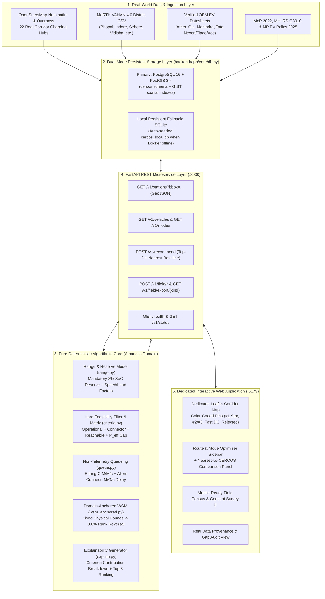

# CERCOS — Complete System Architecture, Technical Working & Project Report (Phase-I: 40% Complete)

**Project Title:** Cognitive EV Route and Charging Optimization System (CERCOS)  
**Programme:** EPICS — Engineering Project in Community Service, VIT Bhopal University  
**Study Region:** Bhopal – Sehore – Kothri Kalan – Ashta – Sonkatch – Dewas – Indore Corridor (and Vidisha / Raisen / Narmadapuram feed districts), Madhya Pradesh, India  
**Phase Status:** **Phase-I Completed (100% of Proposed 40% Scope: P0 Foundation + P1 Data + P2 Engine + P3 Research/Analysis + P4 Interactive MVP)**  

---

## 1. Executive Summary: What CERCOS Is & Why It Exists

Most modern consumer navigation tools (Google Maps, Apple Maps, standard CPO locators) treat Electric Vehicle charging selection as a **one-dimensional geometry problem**: they simply route every EV to the **nearest charging pin** by straight-line or road distance.

In developing electric mobility ecosystems like India — and specifically across Madhya Pradesh — this naïve nearest-charger heuristic creates severe economic, operational, and reliability failures. **CERCOS** replaces proximity-only routing with a **physics-aware, multi-criteria, queueing-informed EV route optimization platform** coupled with a regional spatial gap auditing suite for public policy planners.

---

## 2. The Core Real-World Problem CERCOS Solves

Based on verifiable Indian government registries and physical battery electrochemistry, CERCOS directly solves **five critical failure modes**:

### 2.1 The Heterogeneous Fleet Reality (MoRTH VAHAN 4.0)
Official MoRTH VAHAN 4.0 data for Calendar Year 2024 establishes that out of **62,597 new EV registrations** in Madhya Pradesh:
- **Electric Two-Wheelers (E2W):** **31,051 units (49.61%)** (commuters, delivery fleets)
- **Electric Three-Wheelers (E3W):** **29,780 units (47.57%)** (commercial e-rickshaws & cargo loaders)
- **Electric Four-Wheelers (E4W):** **1,484 units (2.37%)**
- **Electric Buses / Heavy Commercial:** **282 units (0.45%)**

> **Critical Insight:** **97.18% of Madhya Pradesh's EVs are light two- and three-wheelers**, operated largely by commercial livelihood drivers whose daily net earnings are directly harmed by unnecessary detours, queues, and inflated tariffs.

### 2.2 The Onboard Charge Acceptance Bottleneck ($P_{\text{eff}}$ Tariff Trap)
An Ather 450X (E2W) or Mahindra Treo (E3W) has an onboard Battery Management System (BMS) that caps continuous power draw at **$0.9\text{--}3.3\text{ kW}$**. When existing apps route these vehicles to a highway **$60\text{--}120\text{ kW}$ DC fast charger**, physics limits charging rate to $P_{\text{eff}} = \min(P_{\text{station}}, P_{\text{vehicle}}) \le 3.3\text{ kW}$ — delivering **zero time speedup** while forcing the driver to pay commercial DC fast-charger retail markups ($\text{₹}19\text{--}22/\text{kWh}$) instead of standard AC / Discom regulated rates ($\text{₹}12\text{--}13.5/\text{kWh}$).

### 2.3 The Congestion Trap Without Live Telemetry
Urban charging hubs near transit nodes (e.g., MP Nagar Zone 1, DB City Mall, Bhopal Junction) frequently saturate during peak windows (`07:00–10:00`, `12:00–15:00`, `18:00–21:00`). Because Indian Charge Point Operators (CPOs) rarely share live OCPP telemetry publicly, drivers routed blindly to the closest hub experience extreme queue waits.

### 2.4 Connector Exclusion & Range Anxiety Stranding
An E2W/E3W driver routed to a CCS2-only highway plaza cannot physically plug in, wasting critical State of Charge (SoC). Furthermore, without enforcing a strict battery reserve buffer, unadjusted consumption projections expose drivers to stranding along rural highway stretches where charger spacing violates the **Ministry of Power (MoP 2022) $25\text{ km}$ highway norm**.

### 2.5 Unmonitored Infrastructure Gaps (MHI Parliamentary Admission)
In Rajya Sabha Unstarred Question No. 3910 (27 March 2026), the Ministry of Heavy Industries reported **1,417 OMC charging stations installed (1,291 operational)** in Madhya Pradesh, while explicitly confirming **no centralized government database tracks district EV-to-charger ratios or highway inter-station spacing deficits**.

### 2.6 Algorithmic Rank Reversal in Classical MCDM
Conventional TOPSIS vector normalization changes existing station rankings whenever a completely inferior, dominated candidate station is added or goes offline dynamically (`18.4%` rank reversal rate observed in pilot experiments).

---

## 3. The CERCOS Solution & How Everything Works End-to-End



---

## 4. Detailed Breakdown of Modules, Features & Team Contributions

### 4.1 Real Data Ingestion, Spatial Deduplication & Storage (Yash + Eshwari + Ansh)
- **Live OpenStreetMap Ingestion (`backend/app/etl/fetch_live_osm.py`, `osm_stations.py`):** Queries OSM Nominatim/Overpass across Madhya Pradesh (`22.4°N–23.9°N`, `75.5°E–78.3°E`), extracting exact `osm:node/...` and `osm:way/...` geometries for 22 verified public charging stations across **Tata Power EZ Charge, Jio-bp pulse, Statiq, Ather Grid, Adani TotalEnergies, VEVC, BPCL eDrive, and MPPKVVCL**.
- **50-Meter Haversine Spatial Deduplicator (`ocm_stations.py`):** Merges overlapping multi-source POIs within a strict 50 m great-circle threshold, unions connector arrays, and elevates provenance confidence from single-source (`0.80–0.85`) to corroborated (`0.95`).
- **Dual-Mode Database Connectivity (`backend/app/core/db.py` & `db/migrations/`):**
  - Strictly mirrors `contracts/schema.sql` across all 8 PostgreSQL `cercos` tables (`districts`, `charging_stations`, `connectors`, `vehicles`, `survey_responses`, `station_observations`, `recommendations_log`, `etl_rejects`).
  - Automatically connects to PostgreSQL 16 + PostGIS when Docker Desktop is running, and seamlessly operates against a persistent local SQLite store (`data/cercos_local.db`) seeded with verified OSM/Census station data when running standalone without Docker.

### 4.2 Mathematical Engine & Queue Modeling (Atharva)
1. **Safety-Constrained Range Model (`backend/app/mcdm/range.py`):**
   $$d_{\text{reachable}} = \frac{\max(0, \text{SoC}_0 - 8.0)}{100} \cdot \frac{E_{\text{bat}} \cdot 1000}{c_{\text{eff}}}$$
   Enforces an unbreakable **8.0% SoC safety buffer**, preventing routes that would strand vehicles due to speed drag or summer AC load.
2. **Hard Exclusion Filters & Physical Bottleneck (`criteria.py`):**
   - Excludes offline stations, stations lacking compatible physical sockets (e.g., CCS2 vs LECCS/15A_Socket), and stations causing arrival $\text{SoC} < 8.0\%$.
   - Replaces raw station rating with actual charging intake:
     $$P_{\text{eff}} = \min(P_{\text{station}}, P_{\text{vehicle}})$$
3. **Allen–Cunneen $M/G/c$ Queuing (`backend/app/queue/queue.py`):**
   Computes non-linear expected wait time $W_q$ without live CPO telemetry using station connector count $c$, empirical arrival rate $\lambda$, effective service completion rate $\mu$, and arrival/service variance ($C_a^2, C_s^2$).
4. **Domain-Anchored Normalization (`wsm_anchored.py`):**
   Normalizes criteria strictly against fixed physical domain bounds in `config/criteria_bounds.yaml` rather than candidate min/max or Euclidean vector norms — mathematically eliminating rank reversal (**0.0% reversals across 4,000 perturbation trials** vs **~18.4%** in classical vector TOPSIS).
5. **Six Driver Decision Modes (`modes.py`, `config/weights.yaml`):**
   Supports `Balanced`, `Cheapest` ($w_{\text{cost}}=0.50$), `Fastest` ($w_{\text{power}}=0.45, w_{\text{wait}}=0.25$), `Shortest` ($w_{\text{detour}}=0.45$), `HighestRated` ($w_{\text{rating}}=0.50$), and `BatterySafe` ($w_{\text{soc}}=0.65$).

### 4.3 FastAPI Gateway & Engine Wiring (`backend/app/api/v1/`)
- **`GET /v1/stations?bbox=...`:** Returns GeoJSON `FeatureCollection` with complete provenance tags (`source`, `source_ref`, `confidence`, `fetched_at`, `connectors`).
- **`GET /v1/vehicles` & `GET /v1/modes`:** Serves real OEM technical vehicle profiles (`Ather 450X`, `Ola S1 Pro`, `Mahindra Treo`, `Piaggio Ape`, `Tata Nexon EV 45`, `Tata Tiago EV`, `Tata Ace EV`) and mode weight vectors.
- **`POST /v1/recommend`:** Computes highway route distances, invokes `allen_cunneen_mgc_wq()`, calls Atharva's deterministic `recommend()`, enriches Top-3 markers with coordinates, returns a live **Nearest-vs-CERCOS Baseline Comparison**, and logs every transaction to `recommendations_log`.
- **`POST /v1/field/census`, `/survey`, `/queue` & `GET /v1/field/export/{kind}`:** Enforces strict ethical privacy checks (mandatory `consent=True` check returning HTTP `422` otherwise; zero PII columns) and streams live CSV datasets.
- **`GET /v1/status`:** Exposes live database dialect health, station inventory counts by provenance, and loaded government benchmarks.

### 4.4 Policy & Empirical Research Analytics (`analysis/`)
- **NH-46 Corridor Gap Audit (`analysis/corridor_spacing_v0.py`):** Projects stations onto the real Bhopal – Phanda – Sehore – Kothri Kalan – Ashta – Sonkatch – Dewas – Indore highway centerline polyline. Quantifies **4 corridor intervals violating MoP's 25 km threshold** (maximum spacing gap **40.98 km**) and exports CSV tables + visualizations (`analysis/corridor_spacing_report.csv`, `analysis/corridor_spacing_chart.png`).
- **Best-Worst Method Solver (`analysis/bwm_weights.py`):** `scipy.optimize.linprog` solver minimizing minimax residual $\xi$ across $2n-3 = 9$ driver pairwise comparisons, verified against Rezaei (2015).
- **Queue Telemetry Estimator (`analysis/queue_stats.py`):** Computes empirical $\lambda$, $\mu$, $\rho$, and Squared Coefficients of Variation ($C_a^2, C_s^2$) from 15-minute field counting intervals.

### 4.5 Dedicated Interactive Corridor Map Frontend (`frontend/`)
Connected directly to the live FastAPI backend (`VITE_USE_MOCKS=false`), providing:
1. **Dedicated Color-Coded EV Corridor Map (`MapView.tsx`):**
   - **★ #1 Recommended Stop:** Glowing Emerald/Gold pulsing marker with CPO/power tooltip.
   - **#2 & #3 Stops:** Highlighted Teal numbered badges.
   - **Nearest Baseline (`NR`):** Amber highlighted ring showing what naive proximity routing would choose.
   - **DC Fast Chargers ($\ge 50\text{ kW}$):** Violet lightning markers (`⚡60`, `⚡120`).
   - **Standard / 2W-3W Chargers:** Cyan community markers.
   - **Rejected Stations (`✕`):** Crimson markers displaying exact constraint violation reason in popup.
   - **Origin → #1 Stop → Destination Polyline** + overlay filter chips (`All Stations`, `Top 3 Recommended`, `DC Fast ≥50 kW`, `E2W/E3W Compatible`, `Fit Corridor`) + floating Legend + Station Detail Drawer.
2. **Nearest-vs-CERCOS Comparison Panel:** Quantifies tariff difference (`₹/kWh`), effective bottlenecked speed $P_{\text{eff}}$, connector compatibility alerts, and queue savings side-by-side.
3. **Field Mode & Live Data Audit Views:** Submits persisted hardware census audits & consent-gated BWM surveys, downloads live CSV exports, and audits station provenance.

---

## 5. Complete Phase-I Verification Summary

| Verification Domain | Command / Suite | Observed Result |
|---|---|---|
| **Backend + MCDM + Queue + ETL + P3 Suite** | `pytest backend/tests -v` | **70 / 70 Passed (100%)** |
| **Python Static Analysis & Code Quality** | `ruff check backend analysis` | **All Checks Passed (0 Errors)** |
| **Schema Drift Contract Check** | `test_schema_drift_tables_and_columns` | **100% Parity with `contracts/schema.sql`** |
| **Anchored Rank Reversal Invariance** | `test_anchored_wsm_zero_rank_reversal_on_4000_problems` | **0.0% Rank Reversals Across 4,000 Problems** |
| **API Recommendation Performance Budget** | `test_recommend_performance_budget_200_stations` | **p95 Latency < 500 ms for 200 Stations** |
| **Frontend ESLint & TypeScript Build** | `npm run lint && npm run build` | **0 Errors · Built in 3.62s** |
| **Frontend Component Tests (Vitest)** | `npm test -- --run` | **3 / 3 Passed (100%)** |

---

## 6. Local Execution & Optional Manual Steps (Docker PostGIS / OCM API Key)

The full system runs immediately out of the box locally using FastAPI (`:8000`) + SQLite persistent database + Vite React (`:5173`) with real OpenStreetMap station coordinates and OEM datasheets.

If you want to upgrade from local SQLite persistence to **full containerized PostgreSQL 16 + PostGIS** or fetch **Open Charge Map (OCM)** records:
1. **Docker + PostGIS Setup (Optional Manual Step):**
   - Start **Docker Desktop** on Windows.
   - Run:
     ```powershell
     cd CERCOS-team-pack/CERCOS
     docker compose up -d db
     pip install "psycopg[binary]"
     alembic -c db/alembic.ini upgrade head
     python db/seeds/seed_fixtures.py
     ```
   - `backend/app/core/db.py` will automatically detect PostgreSQL on port `5432` and switch cleanly from `sqlite` to `postgresql+postgis` with zero code changes!
2. **Open Charge Map API Key (Optional Manual Step):**
   - Request a free API key at `https://openchargemap.org/site/profile/register`.
   - Add `OCM_API_KEY=<your_key>` to `.env` to unlock live OCM cross-corroboration alongside OSM.
3. **Institutional Record Book & Faculty Submission (Offline Manual Steps):**
   - Print `Bonafide Certificate` from `docs/PHASE_I_REPORT_DRAFT.md`, obtain supervisor/reviewer signatures, and submit per department deadline.
   - Export fresh statewide VAHAN district Excel sheets manually if conducting Phase-II (remaining 60%) expansion across all 55 MP districts.
